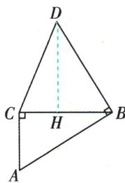

> [!success]- 必刷题
>
> > [!success] **【答案】** 8
>
> > [!note]- **【解析】**
> > 如图, 过点 D 作 $DH \perp BC$ 于 H, $\therefore \angle BHD = 90^{\circ}, \therefore \angle HBD + \angle HDB = 90^{\circ}.$ ∵ 将 AB 绕点 B 顺时针旋转 $90^{\circ}$ 得到 BD,
> >
> > 思路分析
> > 过点 D 作 $DH \perp BC$ 于 H，由同角的余角相等，可得 $\angle CBA = \angle BDH$ ，从而证得 $\triangle ACB \cong \triangle BHD(AAS)$ ，则有 DH = BC = 4，由此即可求解.
> >
> > $$
> > \therefore A B = B D, \angle A B D = 9 0 ^ {\circ}, \therefore \angle A B C + \angle C B D =
> > $$
> >
> > $90^{\circ}, \therefore \angle ABC = \angle BDH.$ 在 $\triangle ACB$ 和 $\triangle BHD$ 中， $\left\{ \begin{array}{l} \angle ACB = \angle BHD = 90^{\circ}, \\ \angle ABC = \angle BDH, \\ AB = BD, \end{array} \right.$ $\therefore \triangle ACB \cong \triangle BHD(AAS), \therefore BC = DH = 4, \therefore S_{\triangle BCD} = \frac{1}{2} BC \cdot DH = \frac{1}{2} \times 4 \times 4 = 8.$ 故答案为8.
> >
> > 
