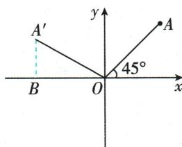
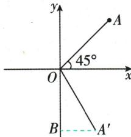

> [!success]- 必刷题
>
> > [!success] **【答案】** $(- \sqrt{3},1)$ 或 $(1,-\sqrt{3})$
>
> > [!note]- **【解析】**
> > 如图(1)，将线段OA绕点O逆时针旋转105°得到线段OA'，过点A'作A'B⊥x轴于点B，∴OA'=OA=2，∠AOA'=105°，∴∠A'OB=180°-45°-105°=30°。在Rt△A'OB中，∠OBA'=90°，∠A'OB=30°，∴A'B= $\frac{1}{2}$ OA'=1，∴OB= $\sqrt{OA'^{2}-A'B^{2}}=\sqrt{3}$ ，∴点A'的坐标为 $(- \sqrt{3}, 1)$ 。
> >
> > 
> >
> > 
> > 图(1)
> > 图(2)
> >
> > 如图(2)，将线段OA绕点O顺时针旋转105°得到线段 $OA'$ ，过点 $A'$ 作 $A'B \perp y$ 轴于点B，∴ $OA'=OA=2,\angle AOA'=105^{\circ},\therefore\angle A'OB=90^{\circ}-(105^{\circ}-45^{\circ})=30^{\circ}$ 。在Rt△A'OB中， $\angle OBA'=90^{\circ},\angle A'OB=30^{\circ},\therefore A'B=\frac{1}{2}OA'=1,\therefore OB=\sqrt{3},\therefore$ 点 $A'$ 的坐标为 $(1,-\sqrt{3})$ 。综上，点 $A'$ 的坐标为 $(- \sqrt{3},1)$ 或 $(1,-\sqrt{3})$ 。故答案为 $(- \sqrt{3},1)$ 或 $(1,-\sqrt{3})$ 。
