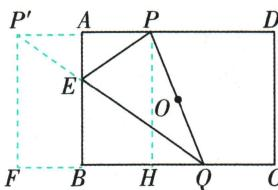

> [!success]- 必刷题
>
> > [!success] **【答案】** $10+2\sqrt{10}$
>
> > [!note]- **【解析】**
> > 如图,作 P 关于 AB 的对
> >
> > 称点 $P'$ ，连接 $P'Q$ ，交 AB 于 E，连接 PE，∴ $P'E = PE$ ，∴ 此时 $PE + QE$ 的值最小，为 $P'Q$ 的
> >
> > 
> >
> > 长, $\therefore \triangle EPQ$ 周长的最小值为 $P'Q+PQ$ 的值.作 $P'F\perp BC$ 交CB延长线于F,作 $PH\perp BC$ 于H.∵AP=3,∴BH=3, $P'A=3=FB$ .∵点O是矩形ABCD的对称中心,PQ经过点O, $\therefore AP=CQ=3.\because BC=8,\therefore BQ=5,\therefore FQ=8.\because P'F=AB=6,\therefore P'Q=10.\because PH=AB=6,$
> >
> > HQ=5-3=2,∴ $PQ=2\sqrt{10}$ ,∴ $\triangle EPQ$ 周长的最小值为 $10+2\sqrt{10}$ . 故答案为 $10+2\sqrt{10}$ .
