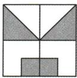
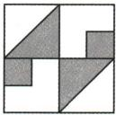
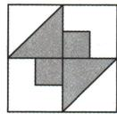
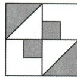

> [!success]- 必刷题
>
> > [!success] **【答案】** 详见解析
>
> > [!note]- **【解析】**
> > 【解】(1)如图(1),是轴对称图形而不是中心对称图形.如图(2),是中心对称图形而不是轴对称图形.(两图答案均不唯一)
> > (2)如图(3)、图(4),既是轴对称图形又是中心对称图形.(答案不唯一)
> >
> > 
> >
> > 
> > 图(1)
> >
> > 
> >
> > 
> > 图(2)
> > 图(3)
> > 图(4)
