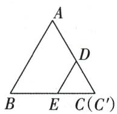
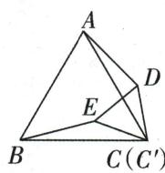
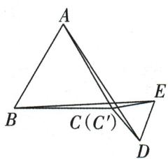

<!-- question-source:start -->
1 [2024 浙江杭州期末, 中] 图(1)是边长分别为 $a$ 和 $b (a > b)$ 的两个等边三角形纸片 $ABC$ 和 $C'DE$ 叠放在一起 ( $C$ 与 $C'$ 重合) 组成的图形. (1) 操作: 固定 $\triangle ABC$ , 将 $\triangle C'DE$ 绕点 $C$ 按顺时针方向旋转 $20^\circ$ , 连接 $AD, BE$ , 如图(2), 线段 $BE$ 与 $AD$ 之间具有怎样的数量关系? 证明你的结论. (2) 操作: 若将图(1)中的 $\triangle C'DE$ 绕点 $C$ 按顺时针方向任意旋转一个角度 $\alpha (0^\circ < \alpha < 180^\circ)$ , 连接 $AD, BE$ , 如图(3), 线段 $BE$ 与 $AD$ 之间的数量关系是否仍符合(1)中的结论? 若是, 请证明; 若不是, 请直接写出 $BE$ 与 $AD$ 之间的数量关系.

图(1)

图(2)

图(3)
<!-- question-source:end -->

![[Q00107254A1]]
