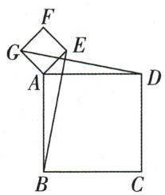
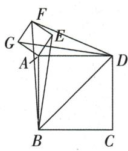

<!-- question-source:start -->
2[2024 福建福州期中,难]正方形 ABCD 和正方形 AEFG 的边长分别为 3 和 1, 将正方形 AEFG 绕点 A 逆时针旋转.
(1) 当旋转至图(1)位置时, 连接 BE, DG, 则线段 BE 和 DG 的关系为 \_\_\_\_;
(2) 连接 BD, BF, DF, 如图(2), 求在旋转过程中 $\triangle BDF$ 的面积的最大值;
(3) 在旋转过程中, 当点 G, E, D 在同一直线上时, 求线段 BE 的长.

图(1)
图(2)
<!-- question-source:end -->

![[Q00107255A1]]
