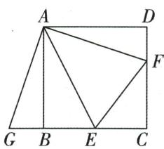

<!-- question-source:start -->
3[2024 上海闵行区质检, 中]如图, 正方形 ABCD 中, E, F 分别在边 BC, CD 上, 且 $\angle EAF = 45^{\circ}$ , 连接 EF, 这种模型属于“半角模型”中的一类. 在解决“半角模型”问题时, 旋转是一种常用的解题方法. 例如将 $\triangle ADF$ 绕点 A 顺时针旋转 $90^{\circ}$ 得到 $\triangle ABG$ , 则可以证明 “EF = BE + DF”, 请写出证明过程.

<!-- question-source:end -->

![[Q00107256A1]]
