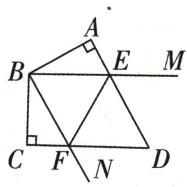
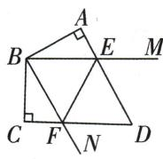
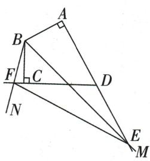

<!-- question-source:start -->
4[2024 江苏南京质检, 中]已知四边形 $ABCD$ 中, $AB \perp AD$ , $BC \perp CD$ , $AB = BC$ , $\angle ABC = 120^{\circ}$ , $\angle MBN = 60^{\circ}$ , $\angle MBN$ 绕 $B$ 点旋转, 它的两边分别交 $AD$ , $DC$ (或它们的延长线)于 $E, F$ .

(1) 当 $\angle MBN$ 绕 $B$ 点旋转到 $AE = CF$ 时 (如图 (1)), $AE$ , $CF$ , $EF$ 之间的数量关系为 \_\_\_\_..

(2) 当 $E$ 在 $AD$ 上, $F$ 在 $DC$ 上, 但 $AE \neq CF$ (如图 (2)) 时, (1) 中结论是否成立? 请说明理由.

(3) 当 $E$ 在 $AD$ 延长线上, $F$ 在 $DC$ 延长线上 (如图 (3)) 时, (1) 中结论是否成立? 若不成立, 线段 $AE$ , $CF$ , $EF$ 之间又有怎样的数量关系? 请直接写出你的猜想.

图(2)

图(1)

图(3)
<!-- question-source:end -->

![[Q00107257A1]]
