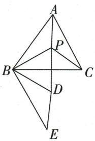
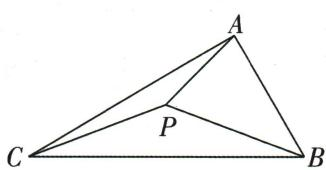
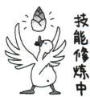

<!-- question-source:start -->
5[2024 江苏南京质检, 中]背景材料: 在 $\triangle ABC$ 所在平面上求一点 $P$ , 使它到三角形的三个顶点的距离之和最小. 这个问题是法国数学家费马向意大利物理学家托里拆利提出的, 所求的点被人们称为“费马点”. 如图(1), 当 $\triangle ABC$ 三个内角均小于 $120^{\circ}$ 时, 费马点 $P$ 在 $\triangle ABC$ 内部, 当 $\angle APB = \angle APC = \angle CPB = 120^{\circ}$ 时, $PA + PB + PC$ 取得最小值.

(1) 如图(1), 将 $\triangle BPC$ 绕点 $B$ 顺时针旋转 $60^{\circ}$ 得到 $\triangle BDE$ , 连接 $PD$ , 可得 $\triangle BPD$ 为等边三角形, 故 $PD = PB$ , 由旋转可得 $DE = PC$ , 因此 $PA + PB + PC = PA + PD + DE$ , 由 \_\_\_\_ 可知, $PA + PB + PC$ 的最小值与线段 \_\_\_\_ 的长度相等;

(2) 如图(2), 在直角三角形 $ABC$ 内部有一动点 $P, \angle BAC = 90^{\circ}, \angle ACB = 30^{\circ}$ , 连接 $PA, PB, PC$ , 若 $AB = 2$ , 求 $PA + PB + PC$ 的最小值.

图(1)

图(2)

<!-- question-source:end -->

![[Q00107258A1]]
