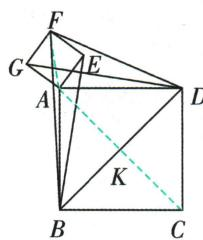
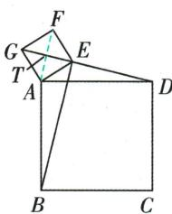
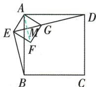
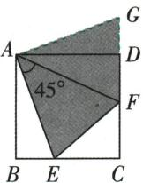
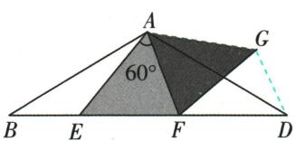

> [!success]- 必刷题
>
> > [!success] **【答案】** BE=DG, BE⊥DG
>
> > [!note]- **【解析】**
> > 【解】(1)设 BE 交 AD 于点 O, 交 DG 于点 J.
> > ∵ 四边形 ABCD、四边形 AEFG 都是正方形，
> > ∴ $\angle BAD = \angle EAG = 90^{\circ}, AB = AD, AG = AE,$ ∴ $\angle BAD + \angle DAE = \angle EAG + \angle DAE, \therefore \angle BAE = \angle DAG.$ 在 $\triangle BAE$ 和 $\triangle DAG$ 中， $\left\{\begin{aligned}AB&=AD,\\ \angle BAE&=\angle DAG,\\ \triangle BAE&\cong\triangle DAG,\end{aligned}\right.$ $\therefore BE=$ AE=AG,
> > DG, $\angle ABE = \angle ADG.$ ∵ $\angle BOD = \angle ABE +$ $\angle BAD = \angle ADG + \angle DJO, \therefore \angle BAD = \angle DJO =$ $90^{\circ}, \therefore BE \perp DG.$ 故答案为 BE=DG, BE⊥DG.
> >
> > (2)如图(1)，连接 $AF, AC$ 设 $AC$ 交 $BD$ 于点 $K$ . $\because$ 四边形 $ABCD$ 、四边形 $AEFG$ 都是正方形， $\therefore AB = AD = 3, \angle BAD = 90^\circ, EA = EF = 1, \angle AEF = 90^\circ,$
> >
> > 
> > 图(1)
> >
> > $$
> > \therefore B D = A C = \sqrt {3 ^ {2} + 3 ^ {2}} = 3 \sqrt {2}
> > $$
> >
> > $AF=\sqrt{1^{2}+1^{2}}=\sqrt{2},\therefore AK=CK=\frac{3}{2}\sqrt{2}.$ 当点 F 在 KA 的延长线上时，点 F 到 BD 的距离最大，为 $\sqrt{2} + \frac{3}{2}\sqrt{2} = \frac{5}{2}\sqrt{2}, \therefore \triangle BDF$ 的面积的最大值为 $\frac{1}{2} \times 3\sqrt{2} \times \frac{5}{2}\sqrt{2} = 7.5.$
> >
> > ## 关键点拨
> >
> > (3)如图(2),当E在线段DG上时,连接AF
> >
> > (3) 注意分两种情形: 如图(2), 当 D, E, G 共线, 点 E 在线段 DG 上时; 如图(3), 当 D, E, G 共线, 点 G 在线段 DE 上时.
> >
> > 交 DG 于 T. ∵ 四边形 AEFG 是正方形, ∴ $AF \perp EG, AF = EG = \sqrt{2}, \therefore AT = FT = TG = TE = \frac{\sqrt{2}}{2}, \therefore DT = \sqrt{AD^{2} - AT^{2}} = \sqrt{3^{2} - \left(\frac{\sqrt{2}}{2}\right)^{2}} = \frac{\sqrt{34}}{2}, \therefore DG = GT + DT = \frac{\sqrt{2}}{2} + \frac{\sqrt{34}}{2}.$ ∵ 同 (1)
> > ∴ $BE=\frac{\sqrt{2}}{2}+\frac{\sqrt{34}}{2}.$
> >
> > 
> > 图(2)
> >
> > $$
> > B E = D G
> > $$
> >
> > 
> >
> > 如图(3)，当 $G$ 在线段 $DE$ 上时，连接 $AF$ 交 $DE$ 于 $M$ . $\because$ 四边形 $AEFG$ 是正方形， $\therefore AF \perp EG, AF = EG = \sqrt{2}, \therefore AM = FM = MG = ME = \frac{\sqrt{2}}{2}, \therefore DM = \sqrt{AD^2 - AM^2} = \sqrt{3^2 - \left(\frac{\sqrt{2}}{2}\right)^2} = \frac{\sqrt{34}}{2}, \therefore DG = DM - GM = \frac{\sqrt{34}}{2} - \frac{\sqrt{2}}{2}.$ $\because$ 同(1)易得 $BE = DG, \therefore BE = \frac{\sqrt{34}}{2} - \frac{\sqrt{2}}{2}.$ 综上所述，线段 $BE$ 的长为 $\frac{\sqrt{34}}{2} + \frac{\sqrt{2}}{2}$ 或 $\frac{\sqrt{34}}{2} - \frac{\sqrt{2}}{2}.$
> >
> > 大招解读 | 半角模型
> > 半角模型特征:①共端点的等线段;
> > - **②**：共顶点的倍半角.通过旋转或作辅助线可以构造全等三角形.常见的半角模型有90°角含45°角和120°角含60°角.半角模型在实际应用中会证两次全等,如图, $\triangle ABE\cong\triangle ADG$ 和 $\triangle AEF\cong\triangle AGF$ .
> >
> > 
> >
> > 
