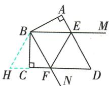
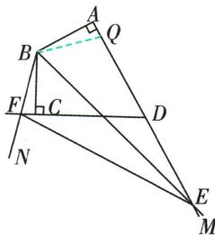
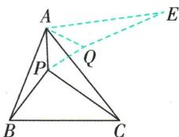
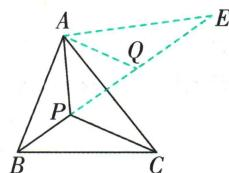

> [!success]- 必刷题
>
> > [!success] **【答案】** $AE + CF = EF$
>
> > [!note]- **【解析】**
> > 【解】(1)∵ $AB \perp AD, BC \perp CD, \therefore \angle A = \angle C = 90^{\circ}$ . ∵ AB = BC, AE = CF, ∴ $\triangle ABE \cong \triangle CBF$ (SAS), ∴ $\angle ABE = \angle CBF, BE = BF$ .
> > ∵ $\angle ABC = 120^{\circ}, \angle MBN = 60^{\circ}, \therefore \angle ABE = \angle CBF = 30^{\circ}, \therefore AE = \frac{1}{2} BE, CF = \frac{1}{2} BF.$ ∵ $\angle MBN=60^{\circ}, BE=BF, \therefore \triangle BEF$ 是等边三角形，∴ $AE+CF=\frac{1}{2}BE+\frac{1}{2}BF=BE=EF.$
> >
> > 思路分析
> > (2)如图(1)，延长FC到H，使CH=AE，连接BH，根据题意可得 $\triangle BCH\cong\triangle BAE$ ，则有BH=BE, $\angle CBH=\angle ABE$ ，进而可证 $\triangle HBF\cong\triangle EBF$ ，推出HF=EF，最后根据线段的等量关系可得结论；
> >
> > (3)如图(2)，在AE上截取AQ=CF，连接BQ，根据题意易得 $\triangle BCF\cong\triangle BAQ$ ，则有BF=BQ， $\angle CBF=\angle ABQ$ ，进而可证 $\triangle FBE\cong\triangle QBE$ ，推出EF=QE即可得出结论.
> >
> > 故答案为 $AE + CF = EF$ .
> >
> > (2)(1)中结论成立,理由如下:延长FC到H,使CH=AE,连接BH,如图(1).
> > ∵ AB⊥AD, BC⊥CD, ∴ ∠A = ∠BCH = 90°. 又
> > ∵ AB = BC, ∴ △BCH ≅ △BAE (SAS), ∴ BH = BE, ∠CBH = ∠ABE. ∵ ∠ABC = 120°,
> > ∠MBN = 60°, ∴ ∠ABE + ∠CBF = 120° - 60° = 60°, ∴ ∠HBC + ∠CBF = 60°, ∴ ∠HBF = ∠EBF. 又∵ BF = BF, ∴ △HBF ≅ △EBF (SAS), ∴ HF = EF. ∵ HF = HC + CF = AE + CF,
> > ∴ EF = AE + CF.
> >
> > 
> >
> > 
> > 图(1)
> > 图(2)
> >
> > (3)(1)中的结论不成立, $AE=EF+CF$ .
> > 在 AE 上截取 AQ = CF，连接 BQ，如图(2).
> > ∵ AB⊥AD, BC⊥CD, ∴ ∠A = ∠BCF = 90°.
> > ∵ AB = BC, ∴ △BCF ≅ △BAQ(SAS), ∴ BF = BQ, ∠CBF = ∠ABQ. ∵ ∠MBN = 60° = ∠CBF + ∠CBE, ∴ ∠CBE + ∠ABQ = 60°. ∵ ∠ABC = 120°,
> > ∴ ∠QBE = 120° - 60° = 60° = ∠MBN,
> > ∴ ∠FBE = ∠QBE. 又∵ BE = BE, ∴ △FBE ≅ △QBE(SAS), ∴ EF = QE, ∴ AE = QE + AQ = EF + CF.
> >
> > 大招解读 费马点模型
> > “费马点”是指到三角形三个顶点距离之和最小的点. 主要分为两种情况:
> > (1) 当三角形三个内角都小于 $120^{\circ}$ 时, 通常将其中一个小三角形绕大三角形的一个顶点旋转 $60^{\circ}$ .
> > 例如: 将 $\triangle APC$ 绕 A 点逆时针旋转 $60^{\circ}$ ，得到 $\triangle AQE$ ，连接 PQ，如图(1)，则 $\triangle APQ$ 为等边三角形，PA=PQ, QE=PC，即 PA+PB+PC=PQ+PB+QE，当 B, P, Q, E 四点共线时，PA+PB+PC 取得最小值，为 BE 的长，如图(2).
> >
> > 
> > 图(1)
> >
> > 
> > 图(2)
> >
> > (2) 当三角形有一个内角大于或等于 $120^{\circ}$ 时, 费马点就是此内角的顶点.
