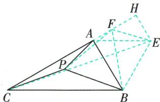

> [!success]- 必刷题
>
> > [!success] **【答案】** 两点之间线段最短,AE
>
> > [!note]- **【解析】**
> > 【解】(1)由两点之间线段最短可知, $PA+PB+PC$ 的最小值与线段AE的长度相等.故答案为两点之间线段最短,AE.
> >
> > (2)如图,将 $\triangle ABP$ 绕点B顺时针旋转 $60^{\circ}$ 得
> >
> > 到 $\triangle EBF$ ，连接PF，CE，AE，作 $EH\bot CA$ 交CA的延长线于H.在Rt△ABC中，
> >
> > 
> >
> > $\because \angle ACB = 30^{\circ}, AB = 2, \therefore BC = 2AB = 4, \therefore AC = 2\sqrt{3}$ . 由旋转的性质可知 $PA = EF, \angle PBF = \angle ABE = 60^{\circ}, PB = BF, AB = BE, \therefore \triangle PBF, \triangle ABE$ 是等边三角形， $\therefore PF = PB, \therefore PA + PB + PC = EF + FP + PC.$ $\because EF + FP + PC \geqslant CE, \therefore$ 当 $C, P, F, E$ 共线时， $PA + PB + PC$ 的值最小. $\because \angle BAC = 90^{\circ}, \angle BAE = 60^{\circ}, \therefore \angle HAE = 180^{\circ} - 90^{\circ} - 60^{\circ} = 30^{\circ}.$ $\because EH \perp AH, AE = AB = 2, \therefore EH = \frac{1}{2} AE = 1, AH = \sqrt{3}, \therefore CE = \sqrt{CH^{2} + EH^{2}} = \sqrt{(3\sqrt{3})^{2} + 1^{2}} = 2\sqrt{7}, \therefore PA + PB + PC$ 的最小值为 $2\sqrt{7}$ .
> >
> > ## 23.2 中心对称
> >
> > ## 23.2.1 中心对称
