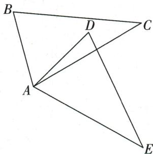
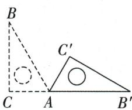

<!-- question-source:start -->
3[2025 广东广州期中]如图, 将 $\triangle ABC$ 绕点 A 顺时针旋转 $60^{\circ}$ 后得到 $\triangle ADE$ , 下列说法错误的是 ( )
A. AB = AD    B. $\angle BAC = 60^{\circ}$ C. $\angle BAD = \angle CAE$ D. $\angle C = \angle E$

(第3题图)

(第4题图)
<!-- question-source:end -->

![[Q00107231A1]]
