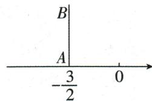

<!-- question-source:start -->
6 如图, 数轴上点 A 对应实数 $-\frac{3}{2}$ , 线段 AB 垂直于数轴, 线段 AB 的长为 2, 现将线段 AB 绕点 A

旋转 $90^{\circ}$ 得到线段 $AB'$ ，求 $B'$ 对应的实数。莉莉看完题目后，写出来如下的解题过程：

解:∵ 将线段 AB 绕点 A 旋转 $90^{\circ}$ 得到线段 $AB'$ , ∴ 点 $B'$ 在点 A 的右边.
又∵ $AB = 2, \therefore B'$ 对应的实数为 $-\frac{3}{2} + 2 = \frac{1}{2}$ .
请问莉莉的解题过程正确吗？如果不正确，请写出正确的解题过程.
<!-- question-source:end -->

![[Q00107234A1]]
