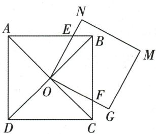

<!-- question-source:start -->
3[2024 河南新乡校级期末,较难]如图,正方形ABCD的边长为a,对角线AC,BD交于点O,正方形GMNO(OG>OB)从初始位置(边ON与OA重合时),绕点O顺时针旋转 $\alpha^{\circ}(0<\alpha<90)$ ,边NO,GO分别与正方形ABCD的边AB,BC交于点E,F(点E,F不与正方形ABCD的顶点重合).有下列三个结论:①OE=OF;② $\triangle AEO$ 与 $\triangle CFO$ 的面积和是 $\frac{1}{4}a^{2}$ ;③四边形EOFB周长的最小值为2a.以上结论正确的为\_\_\_\_(填序号).

<!-- question-source:end -->

![[Q00107237A1]]
