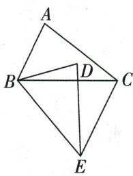
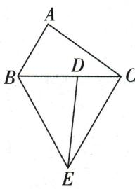

<!-- question-source:start -->
4[2025 广东茂名期中, 中]在 $\triangle ABC$ 中, $\angle ABC<90^{\circ}$ , 将 $\triangle ABC$ 在平面内绕点 $B$ 顺时针旋转(旋转角不超过 $180^{\circ}$ ), 得到 $\triangle DBE$ , 其中点 $A$ 的对应点为点 $D$ , 连接 $CE, CE//AB$ .

(1)如图(1), 试猜想 $\angle ABC$ 与 $\angle BEC$ 之间满足的等量关系, 并给出证明;

(2) 如图(2)，若点 D 在边 BC 上，DC = 2, AC = $\sqrt{19}$ ，求 AB 的长.

图(1)

图(2)
<!-- question-source:end -->

![[Q00107238A1]]
