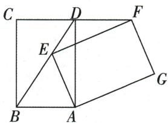
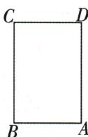

<!-- question-source:start -->
5 思想方法分类讨论 [较难] 将矩形 ABCD 绕点 A 顺时针旋转 $\alpha(0^{\circ}<\alpha<360^{\circ})$ ，得到矩形 AEFG.
(1) 如图, 当点 E 在 BD 上时, 求证: FD = CD.
(2) 当 $\alpha$ 为何值时, GC = GB? 画出图形, 并说明理由.

备用图

<!-- source-part:2 pages:51-100 -->
<!-- question-source:end -->

![[Q00107239A1]]
