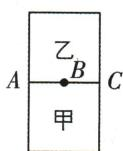

> [!success]- 必刷题
>
> > [!success] **【答案】** C
>
> > [!note]- **【解析】**
> > 如图,正方形甲绕 A 点逆时针旋转 $90^{\circ}$ , 可到正方形乙的位置; 绕 C 点顺时针旋转 $90^{\circ}$ , 可到正方形乙的位置; 绕 AC 的中点 B 旋转 $180^{\circ}$ , 可到正方形乙的位置. 故选 C.
> >
> > 
