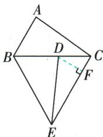

> [!success]- 必刷题
>
> > [!success] **【答案】** 详见解析
>
> > [!note]- **【解析】**
> > 【解】(1) $\angle ABC=\angle BEC$ ,证明如下:
> > ∵ 将 $\triangle ABC$ 在平面内绕点 B 顺时针旋转(旋转角不超过 $180^{\circ}$ ), 得到 $\triangle DBE, \therefore BE = BC,$ ∴ $\angle BCE = \angle BEC.$ ∵ CE // AB, ∴ $\angle ABC = \angle BCE,$ ∴ $\angle ABC = \angle BEC.$
> >
> > (2)如图,过点D作 $DF\perp CE$ 于点F.∵将△ABC在平面内绕点B顺时针旋转(旋转角不超过180°),得到△DBE,
> > ∴ AC = DE = $\sqrt{19}$ , BC = BE, $\angle ABC = \angle DBE, AB = BD,$
> >
> > 
> >
> > $\therefore \angle BEC = \angle BCE.\because CE \parallel AB, \therefore \angle BCE = \angle ABC, \therefore \angle DBE = \angle BEC = \angle BCE, \therefore \triangle BCE$ 是等边三角形， $\therefore BC = BE = EC, \angle DCE = 60^{\circ}, \therefore \angle CDF = 30^{\circ}, \therefore CF = \frac{1}{2} CD = 1, \therefore DF = \sqrt{3}$ . 在 Rt△DEF 中， $EF = \sqrt{DE^{2} - DF^{2}} = \sqrt{19 - 3} = 4,$ $\therefore CE = EF + CF = 5 = BC, \therefore BD = BC - CD = 5 - 2 = 3 = AB, \therefore AB$ 的长为 3.
> >
> > ## 刷素养·
