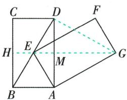
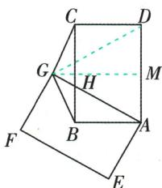

> [!success]- 必刷题
>
> > [!success] **【答案】** (1)
>
> > [!note]- **【解析】**
> > 【证明】由旋转可得, $AE=AB,\angle AEF=\angle ABC=\angle DAB=90^{\circ},EF=BC=AD$ ,
> > ∴ $\angle AEB = \angle ABE$ . 又∵ $\angle ABE + \angle EDA = 90^{\circ} = \angle AEB + \angle DEF, \therefore \angle EDA = \angle DEF.$ 又∵ DE = ED, ∴ $\triangle AED \cong \triangle FDE(SAS), \therefore DF = AE.$ 又
> > ∵ AE = AB = CD, ∴ CD = DF.
> > (2)【解】当α为60°或300°时, GC = GB. 理由如下: 当 GB = GC 时, 点 G 在 BC 的垂直平分线上. 分两种情况讨论:
> > - **①**：当点G在AD右侧时,取BC的中点H,连接GH交AD于M,连接DG,如图(1).∵GC=GB,∴GH⊥BC,∴四边形ABHM是矩形,
> > ∴ $\angle AMH=90^{\circ},AM=BH=\frac{1}{2}AD=\frac{1}{2}AG,\therefore GM$ 垂直平分 AD, ∴ GD = GA = DA, ∴ $\triangle ADG$ 是等边三角形, ∴ $\angle DAG=60^{\circ},\therefore$ 旋转角 $\alpha=60^{\circ}$ .
> >
> > 
> > 图(1)
> >
> > 
> > 图(2)
> > - **②**：当点 G 在 AD 左侧时, 如图(2), 同理可得 $\triangle ADG$ 是等边三角形, $\therefore \angle DAG = 60^{\circ}$ , $\therefore$ 旋转角 $\alpha = 360^{\circ} - 60^{\circ} = 300^{\circ}$ . 综上, $\alpha$ 的度数为 $60^{\circ}$ 或 $300^{\circ}$ .
> >
> > ## 课时 2 旋转作图
