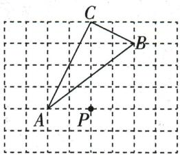

<!-- question-source:start -->
2[2025 黑龙江哈尔滨质检]如图是由小正方形组成的 $8 \times 6$ 网格, 每个小正方形的顶点叫格点. 点 $A, B, C, P$ 都在格点上, 仅用无刻度的直尺在给定的网格中画 $PN \perp AC$ , 且 $PN = AC$ , 画出线段 $PN$ ; 若线段 $AC$ 绕某一点旋转得到线段 $PN$ (点 $P$ 与点 $C$ 对应), 画出旋转中心 $O$ .

<!-- question-source:end -->

![[Q00107241A1]]
