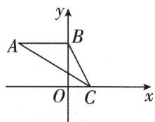

<!-- question-source:start -->
3[2025 河南许昌期中]如图,等腰 $\triangle ABC$ 的顶点 $B$ 在 $y$ 轴上,顶点 $C$ 在 $x$ 轴上,已知 $B(0,2)$ , $A(-\sqrt{5},2),AB=BC$ ,将 $\triangle ABC$ 绕点 $C$ 顺时针旋转,每次旋转 $90^{\circ}$ ,若旋转后点 $A$ 的对应点 $A'$ 的坐标为 $(2+\sqrt{5},-2)$ ,则旋转的次数可能是()

A. 71 B. 72 C. 73 D. 74
<!-- question-source:end -->

![[Q00107242A1]]
