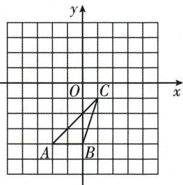

<!-- question-source:start -->
4[2024 山东济宁期末]如图,在平面直角坐标系中,已知 $A(-2,-4)$ , $B(0,-4)$ , $C(1,-1)$ .

(1)画出 $\triangle ABC$ 绕点O逆时针旋转90°后得到的 $\triangle A_{1}B_{1}C_{1}$ ;

(2) 将 (1) 中所得 $\triangle A_{1}B_{1}C_{1}$ 先向左平移 4 个单位, 再向上平移 2 个单位得到 $\triangle A_{2}B_{2}C_{2}$ , 画出 $\triangle A_{2}B_{2}C_{2}$ ;

(3) 若 $\triangle A_{2}B_{2}C_{2}$ 可以看作 $\triangle ABC$ 绕某点旋转得来的, 则旋转中心的坐标为 \_\_\_\_.

<!-- question-source:end -->

![[Q00107243A1]]
