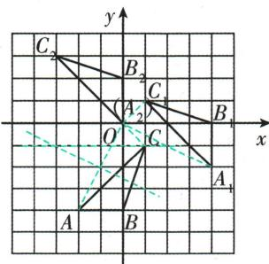

> [!success]- 必刷题
>
> > [!success] **【答案】** D
>
> > [!note]- **【解析】**
> > ∵ $B(0,2)$ , $A(-\sqrt{5},2)$ , ∴ OB=2, $BC=AB=\sqrt{5}$ , ∴ $OC=\sqrt{BC^{2}-OB^{2}}=1$ , ∴ $C(1,0)$ . 由旋转可知，第1次旋转后，点 $A_{1}(3,\sqrt{5}+1)$ ; 第2次旋转后，点 $A_{2}(\sqrt{5}+2,-2)$ ; 第3次旋转后，点 $A_{3}(-1,-\sqrt{5}-1)$ ; 第4次旋转后，点 $A_{4}(-\sqrt{5},2)$ ; ∴ 每旋转4次为一个循环，∴ 若旋转后点A的对应点 $A'$ 的坐标为 $(2+\sqrt{5},-2)$ ，则旋转的次数应为 $4n+2(n$ 为自然数 $)$ . 当 $4n+2=71$ 时， $n=17\frac{1}{4}$ （舍去）；当 $4n+2=72$ 时， $n=17\frac{1}{2}$ （舍去）；当 $4n+2=73$ 时， $n=17\frac{3}{4}$ （舍去）；当 $4n+2=74$ 时，n=18，符合题意. 故选D.
> >
> > 关键点拨4.【解】(1)如图, $\triangle A_{1}B_{1}C_{1}$ 即为所作.
> >
> > (3) 由对应点到旋转中心的距离相等可知旋转中心在对应点连线的垂直平分线上.
> >
> > (2)如图, $\triangle A_{2}B_{2}C_{2}$ 即为所作.
> >
> > 
> >
> > (3)如图,作 $B_{2}B$ 和 $AA_{2}$ 的垂直平分线可以发现两者交于点 $(-3,-1)$ ，即旋转中心的坐标为 $(-3,-1)$ .故答案为 $(-3,-1)$ .
