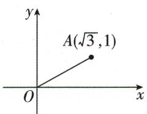
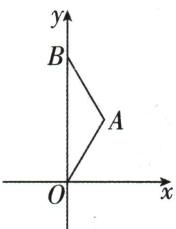

<!-- question-source:start -->
1[中]如图, AO 与 x 轴正方向的夹角为 $30^{\circ}$ , 已知点 A 的坐标为 $(\sqrt{3}, 1)$ , 将线段 AO 绕原点 O 旋转 $150^{\circ}$ 得 $A'O$ , 则此时点 $A'$ 的坐标为 \_\_\_\_.

(第1题图)

(第2题图)
<!-- question-source:end -->

![[Q00107246A1]]
