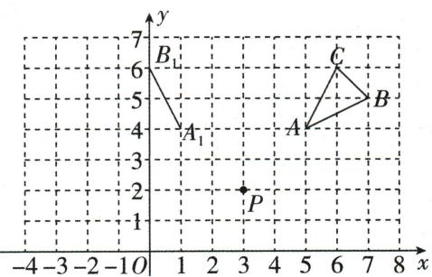

<!-- question-source:start -->
4[2025 山东青岛期中]如图,在直角坐标系中,线段 $A_{1}B_{1}$ 是将 $\triangle ABC$ 绕着点 $P(3,2)$ 逆时针旋转一定角度后得到的 $\triangle A_{1}B_{1}C_{1}$ 的一部分,则点 $C$ 的对应点 $C_{1}$ 的坐标是 ( )

A. $(-2,4)$ B. $(-1,6)$ C. $(-1,4)$ D. $(-1,5)$

建议用时 45 分钟 答案 D38
<!-- question-source:end -->

![[Q00107249A1]]
