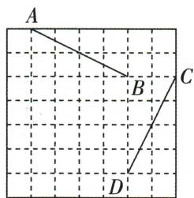
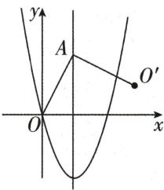

<!-- question-source:start -->
5[中]如图,在边长为1的正方形网格中,A(1,7),B(5,5),C(7,5),D(5,1).线段AB与线段CD存在一种特殊关系,即其中一条线段绕着某点旋转一个角度可以得到另一条线段,则这个旋转中心的坐标为\_\_\_\_.

(第5题图)
(第6题图)
<!-- question-source:end -->

![[Q00107250A1]]
