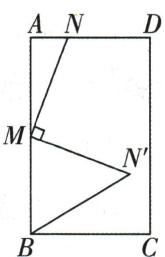
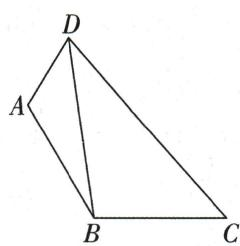

<!-- question-source:start -->
7[2025黑龙江大庆质检,中]如图,在矩形ABCD中,AB=10,BC=6,点M是AB边的中点,点N是AD边上任意一点,将线段MN绕点M顺时针旋转90°,点N旋转到点N',则△MBN'周长的最小值为() A.15 B. $5+5\sqrt{5}$ C. $10+5\sqrt{2}$ D.18

(第7题图)
(第8题图)
<!-- question-source:end -->

![[Q00107252A1]]
