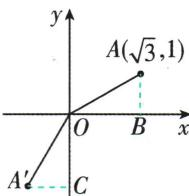

> [!success]- 必刷题
>
> > [!success] **【答案】** $(-2, 0)$ 或 $(-1, -\sqrt{3})$
>
> > [!note]- **【解析】**
> > ∵ 点 A 的坐标为 $(\sqrt{3},1)$ , ∴ $OA=\sqrt{(\sqrt{3})^{2}+1^{2}}=2$ , ∴ $OA'=OA=2$ . 当线段 AO 绕原点 O 逆时针旋转 $150^{\circ}$ 得 $A'O$ 时, ∵ AO 与 x 轴正方向的夹角为 $30^{\circ}$ , ∴ 此时点 $A'$ 落在 x 轴负半轴上, ∴ 此时点 $A'$ 的坐标为 $(-2,0)$ . 当线段 AO 绕原点 O 顺时
> >
> > 针旋转 $150^{\circ}$ 得 $A'O$ 时，如图，过点 A 作 $AB \perp x$ 轴于点 B，过点 $A'$ 作 $A'C \perp y$ 轴于点 C，则 $\angle ABO = \angle A'CO = 90^{\circ}$ ，AB = 1, OB = $\sqrt{3}$ . ∵ $\angle AOB =$
> >
> > 
> >
> > $30^{\circ}, \angle BOC = 90^{\circ}, \angle AOA' = 150^{\circ}, \therefore \angle A'OC = 30^{\circ}, \therefore \angle A'OC = \angle AOB, \therefore \triangle AOB \cong \triangle A'OC,$ $\therefore A'C = AB = 1, OC = OB = \sqrt{3}, \therefore$ 此时点 $A'$ 的坐标为 $(-1, -\sqrt{3})$ . 故答案为 $(-2, 0)$ 或 $(-1, -\sqrt{3})$ .
