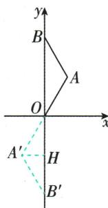

> [!success]- 必刷题
>
> > [!success] **【答案】** $(- \sqrt{3}, -3)$
>
> > [!note]- **【解析】**
> > 由题意知, 将△ABO绕点O逆时针旋转, 每次旋转60°, ∴每旋转6次则回到原位置. ∵2025÷6=337……3, ∴第2025次旋转结束时, 图形相当于旋转了180°. 如图所示, 令第2025次旋转结束时的图形为△A'B'O,
> >
> > 
> >
> > 关键点拨
> > 分两种情况讨论: 线段 AO 绕原点 O 逆时针旋转 $150^{\circ}$ 得 $A'O$ ，线段 AO 绕原点 O 顺时针旋转 $150^{\circ}$ 得 $A'O$ ，进而求出点 $A'$ 的坐标.
> >
> > 作 $A^{\prime}H \perp y$ 轴于 $H$ . $\because AB = OA, \angle OAB = 120^{\circ}$ , $B(0,6)$ , $\therefore OH = \frac{1}{2}OB' = \frac{1}{2}OB = 3$ , $\angle A^{\prime}OH = \angle AOB = 30^{\circ}$ . 设 $A^{\prime}H = x$ , 则 $OA' = 2x$ . 在 Rt $\triangle OA'H$ 中, $(2x)^{2} = x^{2} + 3^{2}$ , $\therefore x = \sqrt{3}$ (负值已舍去), $\therefore A^{\prime}H = \sqrt{3}$ . $\because$ 点 $A'$ 在第三象限, $\therefore A'(-\sqrt{3}, -3)$ , 故答案为 $(- \sqrt{3}, -3)$ .
