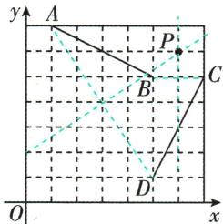
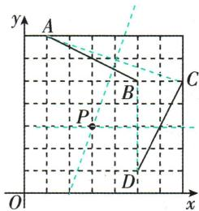

> [!success]- 必刷题
>
> > [!success] **【答案】** (3,3)或(6,6)
>
> > [!note]- **【解析】**
> > 根据题意建立平面直角坐标系. 当点 A 与点 D 是对应点时, 如图(1), ∴ 旋转中心为点 P(6,6). 当点 A 与点 C 是对应点时, 如图(2), ∴ 旋转中心为点 P(3,3). 故答案为(3,3)或(6,6).
> >
> > 
> >
> > 
> > 图(1)
> > 图(2)
