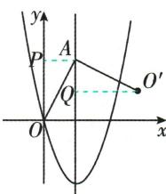

> [!success]- 必刷题
>
> > [!success] **【答案】** $(2, -1)$ 或 $(2, 2)$
>
> > [!note]- **【解析】**
> > ∵ 抛物线 $y = x^{2} - 4x$ 的对称轴为直线 $x = -\frac{-4}{2} = 2$ , ∴ 设点 A 的坐标为 (2, m). 如图, 作 $AP \perp y$ 轴于点 P, 作 $O'Q$
> >
> > 垂直对称轴于点 $Q$ ， $\therefore \angle APO = \angle AQO' = 90^\circ$ ， $\therefore \angle QAO' + \angle AO'Q = 90^\circ$ 。 $\because \angle QAO' + \angle OAQ = 90^\circ$ ， $\therefore \angle AO'Q = \angle OAQ$ 。又 $\because AQ \parallel PO, \therefore \angle OAQ =$
> >
> > 
> >
> > $\angle AOP, \therefore \angle AO'Q = \angle AOP.$ 在 $\triangle AOP$ 和 $\triangle AO'Q$ 中， $\left\{ \begin{array}{l} \angle APO = \angle AQO', \\ \angle AOP = \angle AO'Q, \\ AO = AO', \end{array} \right.$ $\therefore \triangle AOP \cong \triangle AO'Q(AAS), \therefore AP = AQ = 2, PO = QO' = |m|$ ，则点 $O'$ 的坐标为 $(2 + m, m - 2)$ ，代入 $y = x^2 - 4x$ 得 $m - 2 = (2 + m)^2 - 4(2 + m)$ ，解得 $m = -1$ 或 $m = 2, \therefore$ 点 $A$ 的坐标为 $(2, -1)$ 或 $(2, 2)$ . 故答案为 $(2, -1)$ 或 $(2, 2)$ .
