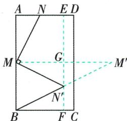

> [!success]- 必刷题
>
> > [!success] **【答案】** B
>
> > [!note]- **【解析】**
> > 如图, 过点 $N'$ 作 $EF \parallel AB$ , 分别交 $AD, BC$ 于点 $E, F$ , 过点 $M$ 作 $MG \perp EF$ 于点 $G$ . $\because$ 四边形 $ABCD$ 是矩形, $\therefore AB \parallel CD$ , $\therefore AB \parallel EF \parallel CD$ , $\therefore$ 易得四边形 $AMGE$ 和四边形 $BMGF$ 都是矩形, $\therefore \angle A = \angle AMG = \angle MGN' =$
> >
> > $90^{\circ}$ . 由旋转的性质得 $\angle NMN' = 90^{\circ}$ , $MN = MN'$ , $\therefore \angle AMN = 90^{\circ} - \angle NMG = \angle GMN'$ , $\therefore \triangle AMN \cong \triangle GMN'$ (AAS), $\therefore MG = AM = \frac{1}{2} AB = 5$ , $\therefore$ 点 $N'$ 在平行于 $AB$ , 且与 $AB$ 的距离为 5 的直线 $EF$ 上运动. 作点 $M$ 关于直线 $EF$ 的对称点 $M'$ , 连接 $M'B$ 交直线 $EF$ 于点 $N'$ , 此时 $\triangle MBN'$ 周长取得最小值, 最小值为 $BM + BM'$ 的值. $\because BM = \frac{1}{2} AB = 5, MM' = 5 + 5 = 10, \therefore BM + BM' = 5 + \sqrt{5^{2} + 10^{2}} = 5 + 5\sqrt{5}$ , 故选 B.
> >
> > 
