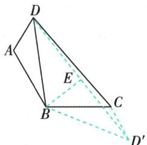

> [!success]- 必刷题
>
> > [!success] **【答案】** $5\sqrt{3}$
>
> > [!note]- **【解析】**
> > 如图, 把 BD 绕点 B 顺时针旋转
> >
> > ## 思路分析
> >
> > $120^{\circ}$ 得到 $BD'$ ，连接 $DD'$ ， $CD'$ ，过点 $B$ 作 $BE \perp DD'$ 于点 $E$ ，则 $\angle DBD' = \angle ABC = 120^{\circ}, DB = D'B = 5.$ $\because \angle ABD + \angle DBC =$ 由“线段 MN 绕点 M 顺时针旋转 $90^{\circ}$ ”构造全等三角形，得出点 $N'$ 所在的直线，然后作点 M 关于该直线的对称点 $M'$ ，转化为“将军饮马”问题，即可求解.
> >
> > 
> >
> > $\angle DBC + \angle CBD' = 120^\circ, \therefore \angle ABD = \angle CBD'$ . 又 $\because AB = CB, DB = D'B, \therefore \triangle ABD \cong \triangle CBD'$ (SAS), $\therefore AD = CD', \therefore AD + CD$ 的最小值为 $CD + CD'$ 的最小值, 即 $DD'$ 的值. $\because BE \perp DD'$ , $BD = BD'$ , $\therefore \angle DBE = \frac{1}{2} \angle DBD' = 60^\circ, DE = \frac{1}{2} DD'$ , $\therefore \angle BDE = 30^\circ$ . $\because BD = 5, \therefore BE = \frac{1}{2} BD = \frac{5}{2}, \therefore DE = \sqrt{5^2 - \left(\frac{5}{2}\right)^2} = \frac{5\sqrt{3}}{2}$ , $\therefore DD' = 2 \times \frac{5\sqrt{3}}{2} = 5\sqrt{3}$ , 故答案为 $5\sqrt{3}$ .
> >
> > ## 大招专题 3 旋转中的常考模型
