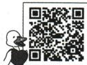
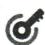

## 24.1.1 圆

电子错题本鸭

## 知识点 1 圆的定义

![[初中/课堂同步/教辅/必刷题/2026版《初中必刷题》数学 RJ 9上/24_第二十四章_圆/24_1_1_圆/questions/Q00106829.md]]

## 知识点 2 与圆有关的概念

![[初中/课堂同步/教辅/必刷题/2026版《初中必刷题》数学 RJ 9上/24_第二十四章_圆/24_1_1_圆/questions/Q00106830.md]]
![[初中/课堂同步/教辅/必刷题/2026版《初中必刷题》数学 RJ 9上/24_第二十四章_圆/24_1_1_圆/questions/Q00106831.md]]
![[初中/课堂同步/教辅/必刷题/2026版《初中必刷题》数学 RJ 9上/24_第二十四章_圆/24_1_1_圆/questions/Q00106832.md]]
![[初中/课堂同步/教辅/必刷题/2026版《初中必刷题》数学 RJ 9上/24_第二十四章_圆/24_1_1_圆/questions/Q00106833.md]]
![[初中/课堂同步/教辅/必刷题/2026版《初中必刷题》数学 RJ 9上/24_第二十四章_圆/24_1_1_圆/questions/Q00106834.md]]
![[初中/课堂同步/教辅/必刷题/2026版《初中必刷题》数学 RJ 9上/24_第二十四章_圆/24_1_1_圆/questions/Q00106835.md]]
![[初中/课堂同步/教辅/必刷题/2026版《初中必刷题》数学 RJ 9上/24_第二十四章_圆/24_1_1_圆/questions/Q00107262.md]]
