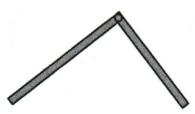
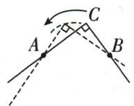

<!-- question-source:start -->
1 新考向传统文化 [2024 福建厦门期末]《周髀算经》中总结了对几何工具“矩”（即直角形状的曲尺,如图(1)所示）的使用之道,其中就有“环矩以为圆”的方法. 我国许多数学家对该方法作了如下更具体的描述:如图(2)所示,在平面内固定两个钉子A,B,保持“矩”的两边始终紧靠两钉子的内侧,转动“矩”,则“矩”的顶点C的运动路线将会是一个圆. 依此描述,请用你学过的一个数学概念或定理解释“环矩以为圆”这种方法的道理: \_\_\_\_.

图(1)

图(2)
<!-- question-source:end -->

![[Q00106829A1]]
