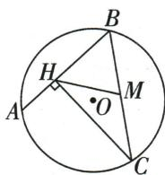
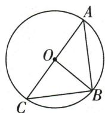

<!-- question-source:start -->
4[2025 江苏南京质检]如图, $AB$ 是 $\odot O$ 的弦, 点 $C$ 是优弧 $\widehat{AB}$ 上的动点 ( $C$ 不与 $A, B$ 重合), $CH \perp AB$ , 垂足为 $H$ , 点 $M$ 是 $BC$ 的中点. 若 $\odot O$ 的半径是 3 , 则 $MH$ 长的最大值是 ( )

A. 3    B. 4    C. 5    D. 6

(第4题图)

(第5题图)
<!-- question-source:end -->

![[Q00106832A1]]
