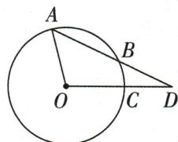
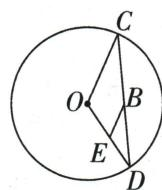

<!-- question-source:start -->
6[2024 江苏南京鼓楼区校级质检]如图, $\odot O$ 的弦 $AB$ 、半径 $OC$ 的延长线交于点 $D, BD = OA$ , 若 $\angle AOC = 105^{\circ}$ , 则 $\angle D =$ \_\_\_\_°.

(第6题图)
(第7题图)
<!-- question-source:end -->

![[Q00106834A1]]
