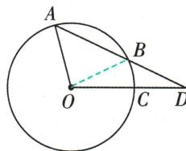

> [!success]- 必刷题
>
> > [!success] **【答案】** 25
>
> > [!note]- **【解析】**
> > 如图, 连接 OB. ∵ BD = OA, OA = OB, ∴ △AOB 和 △BOD 均为等腰三角形. 设 $\angle D = x^{\circ}$ , 则 $\angle BOD = x^{\circ}$ , $\angle OBA =$
> >
> > 
> >
> > $2x^{\circ}$ . ∵ OB = OA, ∴ $\angle A = 2x^{\circ}$ . 在 $\triangle AOB$ 中, $2x + 2x + (105 - x) = 180$ , 解得 x = 25, 即 $\angle D = 25^{\circ}$ .
