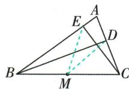

> [!success]- 必刷题
>
> > [!success] **【答案】** 详见解析
>
> > [!note]- **【解析】**
> > 【解】如图,连接 $ME,MD$ . $\because BD,CE$ 是 $\triangle ABC$
> >
> > 的高, M 为 BC 的中点, $\therefore ME = MD = MC = MB = \frac{1}{2}BC, \therefore$ 点 B, C, D, E 在以
> > 点 M 为圆心的同一个圆上.
> >
> > 
> >
> > ## 24.1.2 垂直于弦的直径
