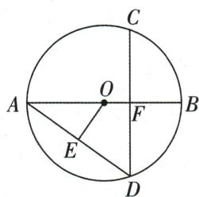
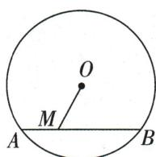

<!-- question-source:start -->
2[2025 浙江宁波期中]如图,AB为 $\odot O$ 的直径,弦 $CD\perp AB$ 于点F, $OE\perp AD$ 于点E,若 $\odot O$ 的半径为3,BF=2,则OE的长为( )
A.1 B. $\sqrt{2}$ C. $\sqrt{3}$ D. $\sqrt{5}$

(第2题图)

(第3题图)
<!-- question-source:end -->

![[Q00106838A1]]
