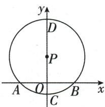

<!-- question-source:start -->
4 如图, 点 P 是 y 轴正半轴上一点, 以 P 为圆心的圆与 x 轴、y 轴分别交于点 A, B, C, D. 已知点 A 的坐标为 $(-3,0)$ , 点 C 的坐标为 $(0,-1)$ , 则点 D 的坐标为 \_\_\_\_.

<!-- question-source:end -->

![[Q00106840A1]]
