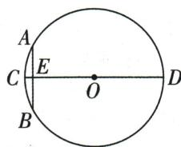

<!-- question-source:start -->
5 新考向传统文化 [2024 广东茂名期中]“圆材埋壁”是我国古代数学著作《九章算术》中的问题:“今有圆材,埋在壁中,不知大小,以锯锯之,深一寸,锯道长一尺,问径几何?”用现在的数学语言可表达为如图,CD 为⊙O 的直径,弦 $AB \perp CD$ 于点 E,CE=1 寸,AB=10 寸,则直径 CD 的长为多少?

<!-- question-source:end -->

![[Q00106841A1]]
