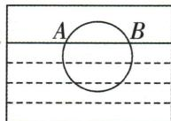
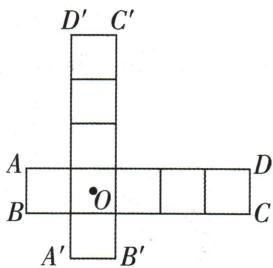

<!-- question-source:start -->
1[2024 河南驻马店期中, 中]如图是一位同学从照片上剪切下来的海上日出时的画面(示意图), 图中太阳与海平线交于 A, B 两点, 他测得图中圆的半径为 10 厘米, AB = 16 厘米. 若太阳从目前所处位置到完全离开海平线的时间为 16 分钟, 则图中太阳升起的速度为 ( )

A. 0.7 厘米/分

B. 0.8 厘米/分

C. 1.2 厘米/分

D. 1 厘米/分

海平线

(第1题图)

(第2题图)
<!-- question-source:end -->

![[Q00106844A1]]
