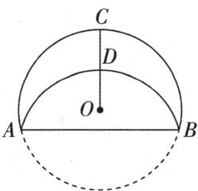
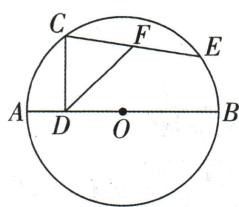

<!-- question-source:start -->
3[2025 山东济南期末, 中]如图, 将半径为 8 的
⊙O 沿 AB 折叠, $\widehat{AB}$ 恰好经过与 AB 垂直的半径
OC 的中点 D, 则折痕 AB 的长为 ( )
A. $4\sqrt{10}$ B. $4\sqrt{15}$ C. 12 D. $8\sqrt{3}$

(第3题图)

(第4题图)
<!-- question-source:end -->

![[Q00106846A1]]
