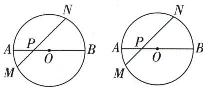

<!-- question-source:start -->
6 思想方法 数形结合 [较难] 如图, 在 $\odot O$ 中, $AB$ 是直径, $P$ 为 $AB$ 上一点, 过点 $P$ 作弦 $MN$ , $\angle NPB = 45^{\circ}$ .

(1) 若 $AP = 2, BP = 6$ , 求 $MN$ 的长;

(2) 若 ${MP} = 3,{NP} = 5$ ,求 ${AB}$ 的长；

(3) 当 P 在 AB 上运动时 ( $\angle NPB = 45^{\circ}$ 不变), $\frac{PM^{2} + PN^{2}}{AB^{2}}$ 的值是否发生变化? 若不变, 请求出其值; 若变化, 请求出其范围.

备用图

电子错题本鸭
<!-- question-source:end -->

![[Q00107263A1]]
