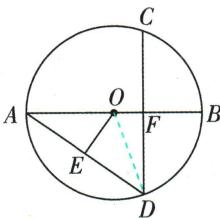

> [!success]- 必刷题
>
> > [!success] **【答案】** C
>
> > [!note]- **【解析】**
> > 如图, 连接 $OD$ . $\because OA = OB = OD = 3, BF = 2, \therefore OF = 1, \therefore AF = 4$ . $\because CD \perp AB$ 于 $F$ , $\therefore \angle AFD = 90^\circ$ . 在 Rt $\triangle OFD$ 中, $DF = \sqrt{OD^2 - OF^2} = \sqrt{3^2 - 1^2} = 2\sqrt{2}$ , 在 Rt $\triangle ADF$ 中, $AD = \sqrt{AF^2 + DF^2} = \sqrt{4^2 + (2\sqrt{2})^2} = 2\sqrt{6}$ . $\because OE \perp AD, \therefore AE = DE = \sqrt{6}, \therefore$ 在 Rt $\triangle AOE$ 中, $OE = \sqrt{OA^2 - AE^2} = \sqrt{3^2 - (\sqrt{6})^2} = \sqrt{3}$ . 故选 C.
> >
> > 
