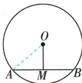

> [!success]- 必刷题
>
> > [!success] **【答案】** D
>
> > [!note]- **【解析】**
> > 当点 M 与点 A 或点 B 重合时, OM 最大, 为 5. 当 $OM \perp AB$ 时, 可得出 M 为 AB 的中点, 此时 OM 最小. 连接
> >
> > 
> >
> > OA, 如图. 在 Rt△AOM 中, OA=5, $AM=\frac{1}{2}AB=$ 4, 根据勾股定理得 $OM = \sqrt{5^{2} - 4^{2}} = 3, \therefore 3 \leqslant OM \leqslant 5.$
> >
> > 故选 **D**.
