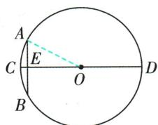

> [!success]- 必刷题
>
> > [!success] **【答案】** 详见解析
>
> > [!note]- **【解析】**
> > 【解】如图, 连接 OA. $\because AB \perp CD$ , 且 AB = 10 寸, $\therefore AE = BE = 5$ 寸. 设 $\odot O$ 的半径 OA 的长为 x 寸, 则 OC = OD = x 寸. $\because CE = 1$ 寸, $\therefore OE = (x - 1)$ 寸.
> > 在直角三角形 AOE 中, 根据勾股定理得 $x^{2}-(x-1)^{2}=5^{2}$ , 解得 x=13, $\therefore CD=2x=26$ , 即直径 CD 的长为 26 寸.
> >
> > 易错警示
> > 有关垂径定理的计算中, 若没有给出特定图形, 一定要对点的位置进行分类讨论, 以防漏解.
> >
> > 
