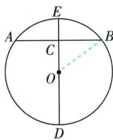
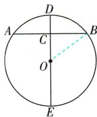

> [!success]- 必刷题
>
> > [!success] **【答案】** C
>
> > [!note]- **【解析】**
> > 当点 D 在优弧 $\widehat{AB}$ 上时, 如图(1), 连接 OB. ∵ 点 C 为弦 AB 的中点, DE 是 $\odot O$ 的直径, AB = 8 cm, ∴ $DE \perp AB$ , $BC = \frac{1}{2} AB = 4 \text{ cm}$ . 又 ∵ OB = OD = 5 cm, ∴ OC = $\sqrt{OB^{2} - BC^{2}} = \sqrt{5^{2} - 4^{2}} = 3 (\text{cm})$ , ∴ CD = OD + OC = 5 + 3 = 8 (cm).
> >
> > 
> >
> > 
> > 图(1)
> > 图(2)
> >
> > 当点 D 在劣弧 $\widehat{AB}$ 上时, 如图(2), 同理, CD = OD - OC = 5 - 3 = 2 (cm). 综上, CD 的长为 2 cm 或 8 cm,
> >
> > 故选 **C**.
